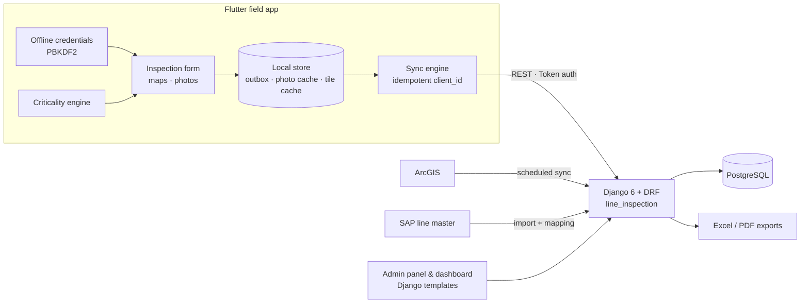

# APTRANSCO Transmission Line Inspection System — Flutter Field App + Django API

> An **offline-first Flutter app** for APTRANSCO line engineers, backed by a **Django 6 REST API** and admin panel. It replaces the paper line-inspection register that engineers carry when they walk 132/220/400 kV transmission lines tower by tower.

[](#)
[](#)
[](#)
[](#)
[](#)

**Context:** built during my AI/ML internship at APTRANSCO (May–Jul 2026) for the APTRANSCO IT Wing.<br/>
**Note:** organisation-specific infrastructure (server addresses, SSO configuration, credentials) is not part of this public description.

---

## Problem

Field engineers inspect every tower on their lines twice a year and record the results in a paper register. Towers are often in places with no mobile signal, nothing proves the engineer actually visited each tower, defects aren't tracked through to closure, and the data never reaches a system where anyone can query it.

## Key features

### Flutter field app
- **Works offline**: a durable **outbox** and **sync engine** queue every inspection and sync it **idempotently** (client-generated `client_id`) once connectivity returns. A sync status bar shows what is pending.
- **Offline sign-in**: credentials are verified locally against a **PBKDF2-HMAC-SHA256** hash, with lockout after repeated failures.
- **Maps**: line and tower maps (`flutter_map`) with GPS location and **cached map tiles** for areas without coverage.
- **Data-driven questionnaire**: the inspection checklist (items, defects, follow-up questions) is downloaded from the server catalog, so it can change without an app release.
- **Defect criticality engine** (`ok → minor → major → critical`) driven by server-defined rules, including tower-type gating.
- **Photo evidence** with thumbnails, plus **Excel / PDF report export** through the OS share sheet.

### Django backend (`line_inspection` app)
- REST API for catalog, subdivisions, lines, towers, map layers, inspections, defect tickets, support requests and a dashboard.
- **GIS master data** (lines, towers, substations) synced from ArcGIS by management commands, plus SAP line import and SAP↔GIS mapping.
- A **custom three-tier role model** with jurisdiction scoping (no `django.contrib.auth`) and token authentication for mobile clients.
- **Admin-editable checklist** and criticality thresholds.
- Server-side exports of inspection history and tickets (openpyxl, ReportLab).

## Architecture



## Tech stack

| Layer | Technology |
|---|---|
| Mobile | Flutter, Dart, flutter_map, geolocator, connectivity_plus, shared_preferences, crypto, share_plus |
| Backend | Django 6, Django REST Framework, PostgreSQL (psycopg 3) |
| Data integration | ArcGIS REST, SAP import (pandas) |
| Exports | openpyxl, ReportLab |

## Project structure

```
transcoapps/
├── line_inspection/                    # Django app: models, api/, services/, management/commands/, tests/
├── transcoapps/                        # Django project settings
└── Aptransco_TIS-main/
    ├── drone_inspection_app/           # Flutter field app
    │   ├── lib/services/offline/       # outbox, sync_engine, local_store, tile_cache, photo_cache
    │   ├── lib/services/               # api, auth, criticality_engine, offline_credentials, export
    │   ├── lib/screens/                # login, hub, inspection form, tabs
    │   └── test/                       # 21 test files
    └── aptransco_backend/              # reference-only donor backend (API contract), not run
```

## Getting started

### Backend
```bash
cd transcoapps
python -m venv .venv && source .venv/bin/activate
pip install -r requirements.txt
# create transcoapps/.env.local with the variables below (never commit it)
python manage.py migrate
python manage.py seed_checklist_catalog
python manage.py runserver 0.0.0.0:8000
```

### Flutter app
```bash
cd transcoapps/Aptransco_TIS-main/drone_inspection_app
flutter pub get
flutter run                 # set the backend URL from the in-app dialog
```

### Environment variables (backend)

| Variable | Purpose |
|---|---|
| `EXTRA_ALLOWED_HOSTS` | Extra hosts, e.g. the dev machine's LAN IP for a phone on the same Wi-Fi |
| `PG_NAME`, `PG_USER`, `PG_PASSWORD`, `PG_HOST`, `PG_PORT` | PostgreSQL |
| `APTRANSCO_AUTH_USER`, `APTRANSCO_AUTH_PASS`, `APTRANSCO_AUTH_URL` | Organisation login gateway |
| `KEYCLOAK_CLIENT_SECRET` | SSO (optional) |

## API (selected)

| Method | Endpoint | Purpose |
|---|---|---|
| POST | `auth/login/`, `auth/logout/` · GET `auth/me/` | Session for the mobile client |
| GET | `catalog/` | Data-driven checklist the app renders |
| GET | `lines/`, `lines/<id>/towers/`, `towers/<id>/`, `map/lines/`, `map/towers/` | Assigned area and map layers |
| POST | `inspections/create/` | Idempotent multi-photo inspection submit |
| GET | `line-inspections/`, `line-inspections/export/` | History and export |
| GET / POST | `tickets/`, `tickets/<id>/close/`, `tickets/export/` | Defect-ticket lifecycle |
| GET | `dashboard/` | Oversight metrics |

## Testing

```bash
python manage.py test line_inspection           # 60 backend tests
cd Aptransco_TIS-main/drone_inspection_app && flutter test   # ~180 Flutter tests
```

## Screenshots

<!-- TODO(Subhash): add phone screenshots with dummy data only (login, map, inspection form, sync bar) -->

## Future improvements

- Activate Keycloak SSO once the identity team registers the redirect URIs.
- Add background sync with WorkManager.
- Build a Play Store release pipeline (Fastlane).
